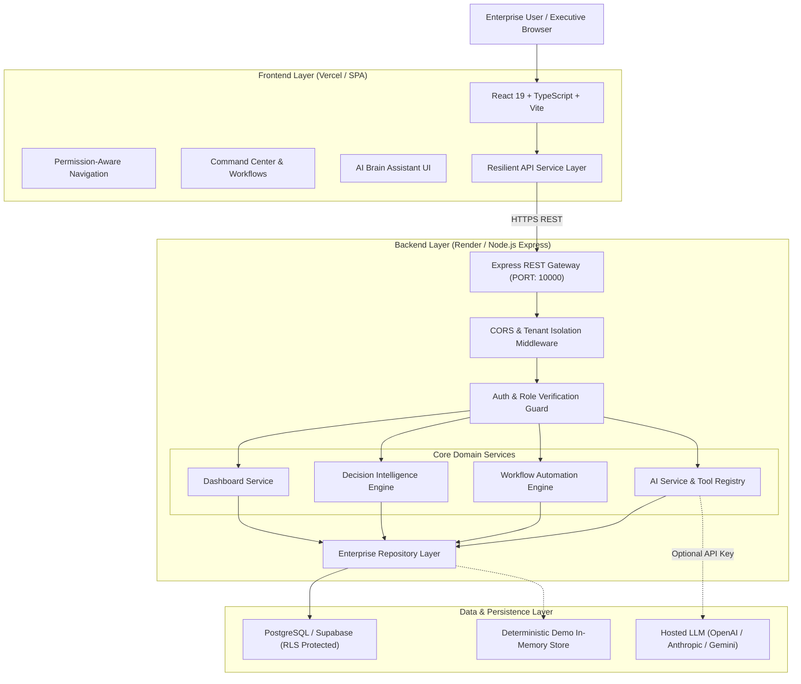

# Entreprise AI OS — System Architecture

## 1. Executive Summary
**Entreprise AI OS** is an AI-powered Enterprise Operations SaaS platform engineered to resolve the fundamental problem of enterprise operational fragmentation:
- **Fragmented Data**: Unified under a multi-tenant operational data model.
- **Disconnected Workflows**: Harmonized through an event-driven Intelligent Workflow Engine.
- **Repetitive Manual Tasks**: Automated via deterministic triggers and human-in-the-loop AI proposals.
- **Inefficient Collaboration**: Connected through cross-department visibility, executive approvals, and activity timelines.
- **Slow Decisions**: Accelerated via deterministic Decision Intelligence bottleneck detection.

---

## 2. High-Level Architecture Diagram

---

## 3. Layer Breakdown

### A. Frontend Layer (`/frontend`)
- **Technology**: React 19, TypeScript, Vite, Tailwind CSS, Lucide Icons.
- **Deployment**: Vercel-ready with single-page application fallback routing.
- **Key Capabilities**:
  - Unified Command Center with live project and cross-department workload health.
  - Interactive Workflow Automation dashboard with one-click test execution and audit runs.
  - Decision Intelligence Radar highlighting critical bottlenecks with transparent evidence.
  - AI Assistant drawer with human-in-the-loop action review and confirmation.
  - 24 preserved agency operations pages (CRM, Leads, Calls, Clients, Content, Video bay, Finance).

### B. Backend Layer (`/backend`)
- **Technology**: Node.js, Express, TypeScript, Zod.
- **Deployment**: Render-ready Web Service with standard `npm install && npm run build` and `npm start`.
- **Key Capabilities**:
  - Strict tenant isolation (`x-org-id`).
  - Token and role verification (`owner`, `admin`, `manager`, `member`).
  - Deterministic Decision Intelligence evaluating project risk, overdue work, and approval latency.
  - Event-driven Workflow Automation engine executing actions: task escalation, notifications, activity events.
  - Server-side AI provider abstraction with server-side authorized tools and human-in-the-loop action proposals.

### C. Data & Security Layer
- **PostgreSQL / Supabase Schema**: Defined in `backend/src/config/schema.sql` with multi-tenant foreign keys, timestamp tracking, and Row-Level Security (RLS) policies.
- **Security Guardrails**:
  - Zero private keys or database credentials exposed to the frontend.
  - Zero arbitrary code execution or raw SQL injection vectors for the AI assistant.
  - All consequential state-modifying actions require explicit human review and confirmation.
